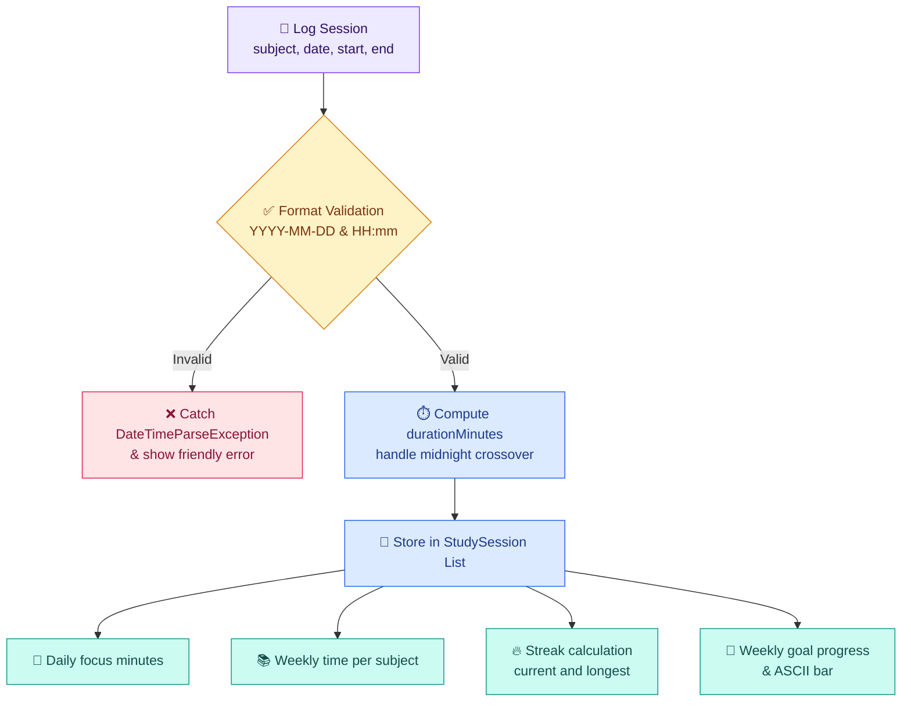
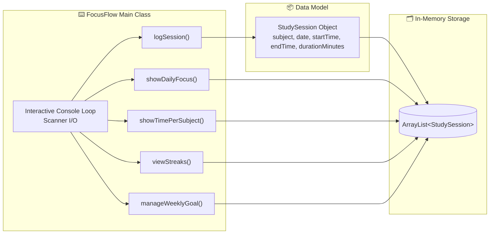

# ⏱️ CP-098 FocusFlow: Study Session Analytics and Streak Tracker


> **Consistency beats cramming.**

FocusFlow is a **pure console-based Java application** that helps students preparing for placements see whether their study time is actually consistent. Log study sessions, then view daily focus minutes, weekly time per subject, current and longest study streaks, and progress against a weekly goal.

It has no graphical interface, web page, server or database. Everything runs in the terminal using only the standard Java library.

---

## 👥 Team
**SYED FARHAN FAWAD** 1AT24CS231, **SHUSHANT SHETTY** 1AT24CS227 , **Java track**
---

## 🚀 How to run

Make sure you have **JDK 17+** installed, then open your terminal in the project folder and run:

```bash
javac FocusFlow.java
java FocusFlow
```

---

## ✨ Features that work

All five compulsory core features and three custom stretch enhancements are fully implemented and working:

| # | Feature | Status | Description |
|:-:|---------|:------:|-------------|
| 1 | 📝 **Log study sessions** | ✅ Working | Record a session with subject, date, start time (`HH:mm`) and end time (`HH:mm`) |
| 2 | 📅 **Show daily focus minutes** | ✅ Working | Calculates and displays total minutes and hours studied on any chosen date |
| 3 | 📚 **Show time per subject (weekly)** | ✅ Working | Aggregates and groups study minutes per subject over the last 7 days |
| 4 | 🔥 **Calculate study streaks** | ✅ Working | Computes current active streak and all-time longest consecutive study days |
| 5 | 🎯 **Set weekly goal & show progress** | ✅ Working | Set a weekly target in minutes and view completion percentage |
| + | 🌙 **Midnight Crossover Handling** *(Stretch)* | ✅ Working | Automatically calculates positive duration when a session starts before midnight and ends after `00:00` |
| + | ⚡ **Smart Date Defaults** *(Stretch)* | ✅ Working | Pressing `Enter` on date prompts automatically defaults to today's date (`LocalDate.now()`) |
| + | 📊 **Visual CLI Progress Bar** *(Stretch)* | ✅ Working | Renders a dynamic 20-character ASCII progress bar `[=========>          ]` in the terminal |

---

## 📌 Overview and Problem Statement

### The problem
Students preparing for placements often *feel* like they study regularly, but without measurement they cannot tell. Long gaps, last-minute cramming and one over-studied subject all stay hidden. Without feedback on consistency, it is hard to build a habit or to balance preparation across subjects.

### The solution
FocusFlow records each study session (`subject`, `date`, `startTime`, `endTime`) and derives all analytics from that single log: daily focus minutes, weekly time per subject, daily study streaks and weekly goal progress.

---

## ⚙️ How It Works

**Log session → validate format → compute duration → aggregate by day, subject and week → calculate streaks → render goal progress.**



---

## 🏗️ Application Structure & Data Model



| Field | Java Type | Description |
|-------|-----------|-------------|
| `subject` | `String` | Subject studied (e.g., Data Structures, Core Java, Aptitude) |
| `date` | `LocalDate` | Calendar date of the session (`YYYY-MM-DD`) |
| `startTime` | `LocalTime` | 24-hour start timestamp (`HH:mm`) |
| `endTime` | `LocalTime` | 24-hour end timestamp (`HH:mm`) |
| `durationMinutes` | `long` | Derived at object creation via `Duration.between(startTime, endTime)` |

---

## 🔥 Streak & Goal Formulas

### Streak Rules
| Term | Definition |
|------|------------|
| **Unique Study Days** | Extracted using Java Streams `.map(s -> s.date).distinct().sorted()` so multiple sessions on the same day count as 1 day |
| **Current Streak** | Consecutive study days ending **today** (`LocalDate.now()`) or **yesterday** (`LocalDate.now().minusDays(1)`) |
| **Longest Streak** | Maximum consecutive day chain where `ChronoUnit.DAYS.between(day1, day2) == 1` |

### Weekly Goal Formula
$$\text{Progress \%} = \min\left(100.0, \frac{\text{focus minutes in last 7 days}}{\text{weekly goal in minutes}} \times 100\right)$$

---

## 🖥️ Sample run

```text
==================================================
   FocusFlow: Study Session Analytics Tracker
==================================================

--- Main Menu ---
1. Log a Study Session
2. Show Daily Focus Minutes
3. Show Time Per Subject (Last 7 Days)
4. View Study Streaks
5. Set & View Weekly Goal Progress
6. Exit
Select an option (1-6): 1
Enter Subject: Data Structures
Enter Date (YYYY-MM-DD) or press Enter for Today: 2025-05-10
Enter Start Time (HH:mm, 24-hour): 18:00
Enter End Time (HH:mm, 24-hour): 20:30
Success! Logged 150 minutes for Data Structures.

--- Main Menu ---
Select an option (1-6): 1
Enter Subject: Core Java
Enter Date (YYYY-MM-DD) or press Enter for Today: 2025-05-11
Enter Start Time (HH:mm, 24-hour): 23:00
Enter End Time (HH:mm, 24-hour): 01:00
Success! Logged 120 minutes for Core Java.

--- Main Menu ---
Select an option (1-6): 2
Enter Date to check (YYYY-MM-DD) or press Enter for Today: 2025-05-10

Total focus time on 2025-05-10: 150 minutes (2h 30m).

--- Main Menu ---
Select an option (1-6): 3

--- Time Per Subject (Last 7 Days) ---
- Data Structures: 150 mins (2h 30m)
- Core Java: 120 mins (2h 0m)

--- Main Menu ---
Select an option (1-6): 4

--- Streak Tracker ---
🔥 Current Streak: 2 days
🏆 Longest Streak: 2 days

--- Main Menu ---
Select an option (1-6): 5
Enter your new weekly goal in minutes (Enter 0 to skip and view progress): 600
Weekly goal set to 600 minutes!

--- Weekly Goal Progress ---
Goal: 600 mins
Completed: 270 mins
Progress: 45.0%
[=========>          ]

--- Main Menu ---
Select an option (1-6): 6
Keep the momentum going! Exiting FocusFlow...
```

---

## 🛠️ Technology Stack

| Technology | Purpose |
|------------|---------|
|  | Core application logic: sessions, analytics, streaks and goals |
|  | Text menu using standard input and output (`Scanner`, `System.out`) |
|  | `LocalDate`, `LocalTime`, `Duration`, and `ChronoUnit` calculations |
|  | In-memory storage (`ArrayList`) and grouping via `Collectors.groupingBy` |

---

## 🏁 Conclusion

FocusFlow turns scattered study hours into a clear picture of consistency: how much you studied, what you studied, how long your streak is, and whether you hit your goal.

**Show up every day. Let the streak do the rest.**


